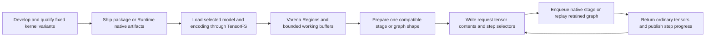

# A native H3 stage within Cozy

2026-11-15. Source/design investigation only. Owner: Codex `/root/h3_boundary_fusion`; this
file alone is assigned on the parent's study branch. No native interface edits, execution,
model downloads, rentals, publication, or claimed speedup in this investigation.

**Recommendation:** first prototype one existing token window of H3's transformer tail,
`glue._Tail.run`, as a package-owned native sequence. Keep the current memory cuts, weight
bindings, kernels and numerical boundaries. Measure it before extending to a complete
transformer block or step. The first version tests whether native orchestration buys anything;
its existence is not evidence that a whole-model persistent kernel would help.

## Pins and the three different meanings of a plan

Fetched RC snapshots inspected:

| Repository | `rc/0.26.0` SHA | Relevant state |
|---|---|---|
| Packages | `ba33c915d2a99206c6513f699f761a4c4d320d79` | H3 `0.13.0rc6`, Q/K/V scope change #920 merged; not publication evidence |
| Runtime | `99d1efb6950de7341b7440d62b18481b5e0a7312` | Includes corrected research collector #2186, merge `c56a52b83`; attention screen #2185 |
| Creator / TensorFS / Varena | `fc79887682cd6924e5dd3bc35e13b7f90dbb344c` | Current native memory ABI and TensorFS adapters |

The earlier research's master snapshots are still valid historical evidence; they are not
these RC pins. Recheck the intended release's exact commits before a benchmark.

- Runtime's [`accel.kernels.Plan`][kernel-plan] passes the device, kernel loader and reporting
  callbacks to `Model.execution_plan`. H3 uses it to install its existing glue, VAE fusion
  and step-cache implementation. It is not an executable model IR.
- Native Varena's [`plan::Plan`][varena-plan] records ordered named phases and their Regions.
  It holds virtual-address reservations, not physical pins; `activate` explicitly performs
  no allocation, pin, fill or sample. Its sizing API chooses and measures legal cuts.
- An H3 native execution program would describe model operations and their schedule. The
  current RC has no `ctx.plan`, `_PreparedScope` or `PreparedRepeat` API to reuse. Older
  handoffs mentioning those names must not be treated as a current implementation contract.

## Baseten's lifecycle and the corresponding Cozy lifecycle

Baseten compiles CUDA kernels into its executable. After allocating a worker's model state,
[`Worker::new`][baseten-worker] runs a seed prefill, begins speculative state, selects sampling
state and captures the decode program; the server then becomes ready. The worker retains its
executable graph. Each request initializes its state and prefills, then launches that retained
graph repeatedly. Capture/instantiate/upload is not performed for every request. Its adaptive
capture includes drafting and conditional verification branches, as detailed in the
[existing source study](external-study.md). The compiled kernel artifact and a process-local
CUDA graph executable are separate objects.

The corresponding Cozy lifecycle is:



Existing Runtime graphs already retain compiled kernels, process-local captures, input layouts,
weight-binding identities and completion ordering. A native H3 forward adds a model schedule;
it should not introduce another graph cache. Unlike a fixed resident decode worker, H3 encounters
different token counts, references, sparse phases, memory cuts and overlays. Those require a
compatible prepared variant or ordinary execution, not blindly replaying one startup graph.
Update tensor contents when the graph accepts them; do not mutate an assumed pointer/layout
contract. The graph owner should decide when known shapes are prepared. Unknown request shapes
cannot all be captured at startup.

At these pins, [`graphs._region_call`][graphs] still captures component roots at idle and declines
multi-GPU, sparse/stateful-producer and armed-overlay paths; streamed roots run as written.
The active cr-297 in-call capture/overlay work is separately owned and has broader behavior.
TensorFS's standalone [`vt.offload` graph implementation][offload] is another existing adapter,
not proof that the same features are wired into Cozy's current Runtime root path. Neither should
be copied into this prototype.

## The actual H3 repeated boundary

[`steps.denoise_official`][steps] and [`H3Transformer.forward`][h3-forward] currently divide work
as follows:

```text
request preparation / conditioning / selected schedule
  validate every timestep/modality row against the selected tables
  arm overlay; create a device scalar selecting its output head
  construct rotary tables and sparse producer's rotary presentation once
  refine/project prompt text once under that overlay
  allocate per-site carried key-mean slots

each denoise step
  update head selector; select dense / seeding / sparse state
  pack projected video + audio + retained text rows
  create this step's time embedding or select overlay table rows
  for each transformer block
    get six modulation/gate tables
    norm/modulate -> Q/K/V -> norm/RoPE -> attention -> output projection
    for each memory-selected token window: _Tail.run   <-- first prototype
  output norm/head projection; return video and audio velocities
  update video and audio schedulers in FP32; preview; on_step

end loop: disarm overlay, clear producer statistics/rotary state
decode and publish ordinary video/audio/latents through existing output contracts
```

**AdaLN is not all hoisted today.** The loop validates coverage up front and pruned/Turbo
checkpoints contain tables. A FULL transformer still computes time embeddings and each block's
modulation in its forward. Hoisting those results is a separate optimization requiring exact
LoRA/table dependencies and a bound on retained bytes. Do not park every block's full-token
modulation output just to remove a few launches.

| Boundary | Current contract a native region must preserve |
|---|---|
| Dense, non-seeding | No carried key-mean write; ordinary dense attention and existing precision policy |
| Last dense step | Seeds each site's post-RoPE key mean for the first sparse step; cannot be treated as the same stateless dense call |
| Sparse | Reads prior key means, computes current V scale, makes value-dependent selection, writes new means/statistics; preserve protected prefixes and exact/dense subpaths |
| References | `official.denoise` can release reference rows between dense and sparse work and restart the loop with a new layout; pointers and shapes then change |
| Multi-GPU | Each rank runs the loop. Ulysses exchanges sequence/head partitions; uneven token shards and memory-selected head groups remain real inputs |
| Hooks / LoRA | Current package overlays arm `lora.Hook`; Runtime may bake weights or apply floating updates. Unknown semantic hooks cannot be bypassed. Pending se-133 moves overlay wiring to `lora.Sites`; do not assume its PR is already at these pins |
| Cancellation / output | `h3.py` passes `ctx.progress` and `raise_if_cancelled`; progress checks cancellation after each scheduler step. Runtime also checkpoints memory pieces. Preserve those returns and ordinary output publication |

Sources: [`producer.Carry`, packing, statistics and validation][producer],
[`official.denoise`][official], [`Context.progress`][context], and
[`execution.catch.Fixed.piece`][pieces]. A single never-returning GPU kernel would bypass the
existing host safe points unless a separately designed device/host protocol replaced them.

## Pointers, residency and cuts

The initial native stage should borrow pointers for **one enqueue**, not keep a second weight
store or full-model allocation. The Python adapter remains inside the existing block/window
scope and calls [`readable`][kernel-plan] for every weight read by pointer. Its resulting tensor
aliases keep the current physical-use ownership alive. All native work uses that caller's live
explicit CUDA stream; no private stream, default-stream launch, allocation pool or device-wide
synchronization is added.

The existing native [Varena C ABI][varena-abi] already supports a later fully native host:

```c
vr_status vr_v1_use(vr_handle gpu, const vr_handle *regions,
                   size_t n, uint64_t stream, vr_handle *out);
vr_status vr_v1_use_ptr(vr_handle use, size_t index, uint64_t *out);
vr_status vr_v1_done(vr_handle use);
vr_status vr_v1_alloc(vr_handle gpu, uint64_t bytes,
                     uint64_t stream, vr_handle *out);
vr_status vr_v1_free(vr_handle allocation);
```

`region_ptr` is a VA, not proof of residency. `use` orders its stream after fills;
`use_wait_ready` waits for those fills, not consumer completion. Other streams must order and
join before `done`. Working frees are stream-ordered. A cached graph's [`Binding`][binding]
checks fill identity, model generation, target geometry and Regions, prepares physical use for
that replay, then releases it; retaining a numeric pointer is insufficient ownership.

Keep [`split(..., Cut(1), out=attn_output, holds=...)`][h3-glue] for the tail and `Cut(2)` for
attention heads. Current `split(out=...)` is not replayed after a partial in-place write. Query
all native scratch/eligibility before mutating output; after submission, propagate failures
through existing Runtime handling. Do not add application OOM retry. The scratch estimator must
include the same outputs, quantized operands and GEMM workspaces as the baseline, with completed
measurements replacing estimates through existing native sizing.

Initial eligibility must not require weights that the existing block binding cannot hold at
once. If current execution binds up/down leaves separately under pressure, keep that path;
do not pin both to make the native experiment run. A later native schedule can acquire/release
per-operation Uses through the existing ABI, rather than demand whole-model residency.
An 8/16/24 GB card is an execution target, not merely a loading test. No larger memory envelope
is acceptable as an unreported benchmark trade.

Prepared identities need actual rows/strides, dtype/encoding, executed width, family/kernel
variant, weight/overlay binding identity and cut geometry. Whole-block variants additionally
need head range, parallel topology, phase, protected-token layout and producer-state slots.
Use bounded row buckets with exact lengths/masks, never padding that changes row amax, selected
keys or protected rows. GPU family selection remains existing development-tuned dispatch.

## Smallest useful prototype and exact private interface proposal

The region is one `_Tail.run` window:

```text
gate+residual+RMSNorm+modulation (BF16 rounding) -> normed rows
ConvRot256 whole-row INT8 quantization -> up GEMM -> [value | gate] BF16
existing SwiGLU+ConvRot256 quantizer -> down GEMM -> BF16
gate+residual -> overwrite this attention-output window
```

Its existing fusion already removes intermediate activation products; do not count that as a
new gain. The initial native sequence should use the same kernels and shapes to isolate host
orchestration. A second, separately measured variant may remove a proven remaining device
materialization. Whole-row scales and eager rounding remain unchanged.

Proposed **package-private**, review-only ABI for one INT8/BF16 topology, not a new Runtime public
API or committed implementation:

```c
struct H3TailShape {
    int32_t device, rows;             // exact local window row count
    int32_t hidden, ffn;              // initially 5376, 14336: glue._widths
    int64_t residual_stride, out_stride, table_stride; // elements
    float norm_epsilon;
};
struct H3I8Weight {
    uint64_t payload, scales, bias;   // INT8 [N,K], FP32 [N], optional BF16 [N]
};
struct H3TailCall {
    H3TailShape shape;
    uint64_t residual, out;           // BF16: read-only residual, in/out attention rows
    uint64_t row_index;               // INT64 [rows], already validated table indices
    uint64_t norm_weight;             // BF16 [hidden]
    uint64_t gate_msa, scale_mlp, shift_mlp, gate_mlp; // BF16 tables
    H3I8Weight up, down;
};
// Pure metadata query. Includes kernel-specific GEMM workspace; allocates nothing.
int32_t h3_tail_i8_scratch_bytes(const H3TailShape *, uint64_t *bytes);
// Enqueue on the caller's stream. Borrow all operands and scratch; retain none.
// Return a launch status, not a promise of GPU completion.
int32_t h3_tail_i8_submit(const H3TailCall *, uint64_t scratch,
                        uint64_t scratch_bytes, uint64_t stream);
```

The Python adapter's proposed private signature is
`run_tail_window(block, residual, row_index, gates, out) -> None`, within the existing
`_Tail.run` scope. It verifies the installed encoding, topology and hooks, gets readable
operands, allocates bounded scratch through the installed allocator, submits, and returns.
The baseline is used before any write when the topology/encoding is unsupported. Preserve the
existing width check: the glue's 5376/14336 shape is not every possible H3 checkpoint.

V1 serves unhooked or already-baked INT8 leaves. An armed unbaked LoRA stays on the current
implementation until its exact factor accumulation and original-input semantics are included
and qualified. This does not retire or weaken the regular/Turbo/user-LoRA paths. FP8, other
widths and collective work require their own admitted variants, rather than reinterpretation
of the above pointers.

**The missing seam is concrete.** Runtime's [native GEMM headers][gemm-header] already expose
torch-free raw-pointer launchers with caller workspace and stream. But [`modules.map`][modules]
exports only `PyInit_*`; a package cannot `dlsym` those internal C++ symbols from the shipped
extension as a supported ABI. A review must select either a private static-link prototype
reusing those objects or a minimal generic native-kernel export. Do not put an H3-specific
schedule into the generic Runtime wheel, duplicate CUDA kernels indefinitely, or declare a
new general model-program interpreter merely to bypass this seam.

Estimated narrow scope, conditional on that build seam: roughly 5–8 files for package adapter,
private native entry/build, receipt probe and documentation; around 3–6 engineer-days of
implementation and 2–5 of qualification once authorized hardware/assets are available. These
are planning estimates, not measured effort or a delivery promise. A complete native H3
application also needs tokenization, conditioning, schedulers, reference/continuation handling,
VAEs, encoding and output custody; its scope is substantially larger and is not estimated by
the transformer-tail experiment.

## Why removing Python is not itself the success criterion

[Unsloth PR #11175][unsloth] reports one resident B200, FP8 H3, 960×544×124, 30 steps/29 denoiser
calls. Five interleaved timed pairs after two warmups measured 32.188 s graphed versus 32.246 s
eager; a never-armed process measured 32.185 s and reserved 3.93 GB less. Replay was exact,
while removing approximately 25.3 s of host forward blocking hardly changed end-to-end time.
This is a bounded counterexample to equating removed host time with critical-path savings.
It establishes neither Cozy's result nor all larger H3 presets, INT8, sparse or streamed cases.

Likewise, Cozy's #920 probe proves exact quantizer reuse for inference/capture, not faster
ordinary eager H3. Current H3 denoising uses no-grad and retains implicit reuse. Native versus
Python, graphed versus eager, and fused versus unfused GPU computation need separate controls.

## Intended-RC full-length A/B profiling recipe — not run

### Readiness and artifacts

1. Freeze the three pins above, exact model checkpoint/lane, Turbo adapter, dependency locks,
   selected kernel artifacts, device UUID/driver and GPU count in a receipt. Confirm all children
   executed the intended captured package; a local parent path alone is not that proof.
2. A is the ordinary intended RC. B is that same RC plus the reviewed native-tail variant only;
   it does not exist yet. Keep two controls: A/A ordinary execution to establish variation, and
   A versus the same current graph policy with native enqueue. A forced graph policy is a
   separate graph-owner experiment. No attention/precision/schedule changes in this A/B.
3. Use an already authorized remote machine, with explicit `--on` and `--gpus=1`; no `new`,
   local model download, or rental is implied. Start with one SM89 INT8 target and later the
   intended second family. Include a memory-constrained run and a resident run, matching each
   pair's limits, preceding requests, allocator/cache state and cut shapes. Record differing
   cuts as an unmatched comparison, not a clean speedup.
4. The corrected collector is merged **as research code**. Current RC does not expose
   `cozy_runtime.graphs.profiles`, and its graph implementation has no calls to the old helper.
   The old request-profile package imports removed `cozy_runtime.models.minimax_h3` and pins
   H3 1.26.3 / Runtime 0.21; it is not runnable as the current RC adapter.

The necessary measurement-only adapter must therefore be reviewed/built first. Put the
unchanged corrected `cr297_profiles.py` and `profile_intervals.py` in one private importable
diagnostic namespace (the helper uses a relative import). Wrap the actual transformer call
in the current `steps.denoise_official`, only when explicitly observing a selected request:

```python
profiled(torch, label, lambda: transformer(**same_arguments),
         at=1, devices=(torch.cuda.current_device(),))
```

No tensor/module hooks on projections: they can change fusion/Rows eligibility. Use unique
labels including request, component and phase. Ordinary runs take the original call with no
profiler; preserve the exact returned values. Export `PROFILES` once per request through an
existing diagnostic output/log receipt. If a full ChromeTrace is needed, export it outside
the annotated window in that private adapter; the current summary collector does not export
one itself. Keep instrumentation identical in A and B. Its CPU/CUDA profiler overhead makes
these diagnostic calls unsuitable for the clean wall-time comparison.

### Exact request and sampling

Use this regular request (single first segment, no references/pickup):

```json
{
  "beats": [{"duration": 15, "description": "[Shot 1] A slow bank of fog crosses the bay. The camera tracks along the cliff edge while gulls ride the wind. Spray climbs the rocks below the gallery."}],
  "soundscape": "Wind and ocean surf, with waves splashing against the rocks.",
  "aspect_ratio": "16:9",
  "seed": 29751,
  "turbo": false,
  "steps": 30,
  "quality": "standard"
}
```

Confirm actual output/receipt geometry is **362 frames, 1344×768 with audio**; the package
snaps frame/canvas geometry, so the JSON alone is not evidence. Turbo is a separate request:
set `turbo` true, omit `steps` entirely, retain `quality=standard`, and verify its selected
checkpoint's fixed schedule (currently eight evaluations). Do not combine its result with
the regular model's timings. Explicit `steps` selects regular H3 even if Turbo was requested.

After the diagnostic adapter and variant artifacts exist, the ordinary command shape is:

```bash
cozy run "$A/minimax-h3/generate" --input regular.json \
  --on "$AUTHORIZED_MACHINE" --gpus=1 --lane int8 \
  --output "$OUT/A-regular-01" --json
cozy run "$B/minimax-h3/generate" --input regular.json \
  --on "$AUTHORIZED_MACHINE" --gpus=1 --lane int8 \
  --output "$OUT/B-regular-01" --json
```

`A`/`B` are captured package-source roots, not unpublished Hub version names. The CLI command
shape above was checked with current `cozy run --help`; it does not use the obsolete
`--idempotency-key` flags in the historical profiling README. Record every returned run ID
and follow an uncertain accepted run instead of resubmitting it blindly.

For each regular/Turbo cell: two unprofiled full-request warmups per arm, then five alternating
pairs with order flipped each pair; retain cold-start results separately. Use fresh comparable
executor histories when switching artifacts cannot preserve equal state. Then run separate
full-length diagnostic requests selecting dense, seeding and sparse transformer calls:

| Standard recipe | Dense sample | Seeding sample | Sparse sample |
|---|---:|---:|---:|
| Regular, 30 steps / 10 dense | step 1 | step 9 | step 10 |
| Turbo, 8 steps / 4 dense | step 1 | step 3 | step 4 |

Indices are zero-based and must agree with the executed schedule. Observe one selected call
per diagnostic request initially to bound trace memory. Do not use `at=2` for a seeding label
that occurs once. Distinguish transformer/transformer_ref, token-refiner attention and VAE
decoder calls; profile the latter separately when their complete-request share warrants it.

### Analysis and qualification

The corrected collector reports an annotated call window, per-device union of actual CUDA
work, aggregate work, observed span and unclassified inactivity. Synthetic GPU annotation
spans are excluded. Never sum repeated component dictionaries, cross-device unions, nested
phase totals or overlapping event durations into a wall-time attribution. Inactivity does
not identify CPU dispatch, paging or a dependency cause by itself. Raw correlation/stream
dependencies are needed to explain the critical path. Use the corrected offline tool for
an exported trace and its exact annotation bounds:

```bash
python research/h3-request-profile/trace_summary.py trace.json.gz \
  --window-start-us "$START_US" --window-end-us "$END_US" --out trace-summary.json
```

Report clean complete-request and denoise latency, sampled dense/seed/sparse times, native
stage time, exact kernels, launch counts, Varena working/pinned/refill bytes, cut geometry,
allocator/driver peaks, transfers, cold/warm state and failures. Verify latents/velocities and
pre-codec video/audio at worker side; return compact hashes/error summaries plus ordinary
media. Bit-identical output is required for the proposed unchanged arithmetic; codec bytes
alone are not its numerical proof. Keep full-size artifacts worker-side until the owner
retrieves the agreed evidence. Add cancellation between windows/steps, a post-cancellation
ordinary request, overlay changes, Ref2VA protected rows and actual multi-GPU execution before
general adoption. Build, kernel screening, graph replay and full-model proof remain separate.

The criterion to enlarge the native region is a repeatable saved GPU/host **critical-path**
interval or reduced necessary memory with correct outputs, not fewer Python frames, one
graph submission, or a persistent-kernel label.

[kernel-plan]: https://github.com/cozy-creator/cozy-runtime/blob/99d1efb6950de7341b7440d62b18481b5e0a7312/src/cozy_runtime/accel/kernels.py
[varena-plan]: https://github.com/cozy-creator/cozy-creator/blob/fc79887682cd6924e5dd3bc35e13b7f90dbb344c/crates/varena/src/plan.rs
[baseten-worker]: https://github.com/basetenlabs/deepseek-ultrafast/blob/76766a97308bfd1658fb055e835d0f92de737dc3/crates/server/src/engine.rs#L243-L249
[graphs]: https://github.com/cozy-creator/cozy-runtime/blob/99d1efb6950de7341b7440d62b18481b5e0a7312/src/cozy_runtime/graphs/__init__.py#L1110
[offload]: https://github.com/cozy-creator/cozy-creator/blob/fc79887682cd6924e5dd3bc35e13b7f90dbb344c/crates/varena/TORCH-OFFLOAD.md
[steps]: https://github.com/cozy-creator/packages/blob/ba33c915d2a99206c6513f699f761a4c4d320d79/minimax-h3/minimax_h3/steps.py#L43
[h3-forward]: https://github.com/cozy-creator/packages/blob/ba33c915d2a99206c6513f699f761a4c4d320d79/minimax-h3/minimax_h3/adaln_pruned.py#L275
[producer]: https://github.com/cozy-creator/packages/blob/ba33c915d2a99206c6513f699f761a4c4d320d79/minimax-h3/minimax_h3/producer.py#L118
[official]: https://github.com/cozy-creator/packages/blob/ba33c915d2a99206c6513f699f761a4c4d320d79/minimax-h3/minimax_h3/official.py#L1587
[context]: https://github.com/cozy-creator/cozy-runtime/blob/99d1efb6950de7341b7440d62b18481b5e0a7312/src/cozy_runtime/author/_context.py#L223
[pieces]: https://github.com/cozy-creator/cozy-runtime/blob/99d1efb6950de7341b7440d62b18481b5e0a7312/src/cozy_runtime/internal/execution/catch.py#L308
[varena-abi]: https://github.com/cozy-creator/cozy-creator/blob/fc79887682cd6924e5dd3bc35e13b7f90dbb344c/crates/varena/include/varena.h
[binding]: https://github.com/cozy-creator/cozy-runtime/blob/99d1efb6950de7341b7440d62b18481b5e0a7312/src/cozy_runtime/internal/residency.py#L816
[h3-glue]: https://github.com/cozy-creator/packages/blob/ba33c915d2a99206c6513f699f761a4c4d320d79/minimax-h3/minimax_h3/glue.py#L1100
[gemm-header]: https://github.com/cozy-creator/cozy-runtime/blob/99d1efb6950de7341b7440d62b18481b5e0a7312/kernels/csrc/gemm/int8.h
[modules]: https://github.com/cozy-creator/cozy-runtime/blob/99d1efb6950de7341b7440d62b18481b5e0a7312/kernels/modules.map
[unsloth]: https://github.com/unslothai/unsloth/pull/11175
